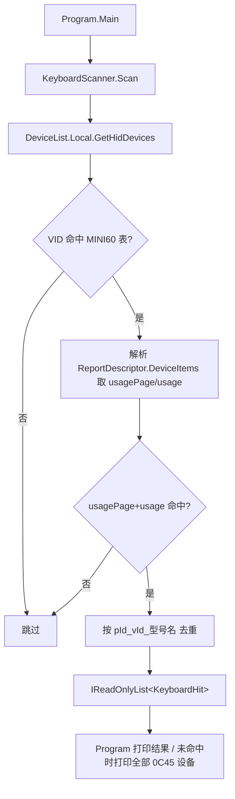

## 产品概述

分析狼蛛 AULA 网页驱动（WebHID）中"罗列键盘设备"的核心逻辑，并在 `aula` 项目中用 C# + HidSharp 复刻该功能（开发目标第一步：搜索键盘 MINI60HE MAX）。

## 核心功能

- 从 `web\assets\index-ittJ_Bat.js`（经 javascript-obfuscator 混淆）还原出的设备枚举逻辑：全量枚举 HID 设备 → 按 (vendorId, productId) 命中设备表 → 再校验该设备顶层集合的 (usagePage, usage) → 命中即识别型号。
- 内置 **MINI60 系列 6 条**设备定义（MINI 60 HE / MINI60HE MAX / MINI 60 HE PRO 及其 Dongle），不做全量 83 款。
- **去重与型号识别**：按 JS 的 `pId_vId_名称` 规则去重，输出识别到的型号名（如 `MINI60HE MAX`）。
- 控制台输出：序号、型号名、VID/PID、实际 usagePage/usage、设备路径；未命中时提示"未发现 MINI60 系列键盘"并列出所有 VID=0x0C45 的 HID 条目以便排查。
- 本版**不做**热插拔监听、**不做**打开设备与读写报告。

## 技术栈

- 语言/框架：C# / .NET 10（`aula\aula.csproj` 已是 SDK 风格 Exe，`ImplicitUsings` + `Nullable` 均开启）
- HID 库：HidSharp 本地源码工程 `HIDSharp264\HidSharp\HidSharp.NETStandard.csproj`（`netstandard2.0`，net10.0 可直接 `ProjectReference`）
- 注意：不要引用旧式 .NET Framework 3.5 的 `HidSharp\HidSharp.csproj`

## 实现思路

把 WebHID 的 `navigator.hid.getDevices()` 语义一比一映射到 HidSharp：

| JS（WebHID） | C#（HidSharp） |
| --- | --- |
| `navigator.hid.getDevices()` | `DeviceList.Local.GetHidDevices()` |
| `device.vendorId / productId` | `HidDevice.VendorID / ProductID` |
| `device.collections[].usagePage/usage` | `device.GetReportDescriptor().DeviceItems[].Usages.GetAllValues()`，值编码为 `(usagePage<<16) | usage` |
| `q1`（设备表） | 静态只读 `AulaKeyboardDevice[]` |
| `addDevice` 反查型号 | `pId+vId` 命中且 `pName` 与 `GetProductName()` 比对（别名数组 `Contains`） |
| `syncRef` 去重 | `Dictionary<string, Hit>`，键 `$"{pid}_{vid}_{name}"` |


关键决策与权衡：

1. **usage 校验必须保留**：同一把物理键盘会暴露多个接口（标准键盘 `0x0001/0x0006`、消费者控制 `0x000C/0x0001`、厂商自定义 `0xFF68/0x0061`）。只有命中表中 (usagePage, usage) 的接口才是驱动可用接口，否则会列出 3 条重复项。这正是 JS `collections.some(...)` 的作用。
2. **不打开设备**：`GetReportDescriptor()` 在 Windows 上走重建描述符路径，无需 `TryOpen`，避免了键盘被独占/权限问题，也与用户"只列出"的选择一致。
3. **型号名优先取设备表**，`GetProductName()` 仅作为别名校验/兜底，避免 Windows 上报的产品名带噪声。
4. **容错**：`GetReportDescriptor()` / `Usages` 对个别设备可能抛异常，单设备级 try-catch 跳过，保证整体扫描不中断。

## 执行细节（防坑）

- HidSharp 无 `HidDevice.UsagePage/Usage/GetUsage()`，必须走 `GetReportDescriptor().DeviceItems` + `Usages.GetAllValues()`。
- 已 obsolete 的成员（`ProductName`/`Manufacturer`/`SerialNumber`/`Max*ReportLength` 属性）一律不用，改用方法式 `GetProductName()` 等，否则 `dotnet build` 会产生警告。
- Windows 上一个 HID 设备接口对应一个 TLC，`DeviceItems` 通常只有 1 项，但仍按"任一顶层集合命中"实现（对齐 JS 的 `some`）。
- 去重键严格照搬 JS：`$"{pId}_{vId}_{name}"`（name = 识别出的型号名）。
- 无需缓存 `DeviceList.Local`（HidSharp 内部管理），每次扫描调用一次 `GetHidDevices()` 即可；设备数量在百级，无性能瓶颈。
- 先只按 VID=0x0C45 预筛再做 usage 解析，减少描述符解析次数。

## 架构设计



分层：`Data`（设备定义与常量表）→ `Scanner`（枚举与匹配，无 IO 副作用）→ `Program`（控制台呈现）。职责单一，后续加热插拔/打开设备只需在 Scanner 上扩展。

## 目录结构

```
d:/code/aicode/hidtest/
└── aula/
    ├── aula.csproj                    # [MODIFY] 新增 ProjectReference -> ..\HIDSharp264\HidSharp\HidSharp.NETStandard.csproj
    ├── AulaKeyboardDevice.cs          # [NEW] 设备定义模型 + MINI60 系列 6 条静态表（pName 别名数组、vId、pId、usage、usagePage、wireless、deviceType）；提供 TryMatch 语义所需的只读数据
    ├── KeyboardScanner.cs             # [NEW] 枚举 HID 设备、解析顶层集合 usage、按 (VID,PID)+(usagePage,usage) 匹配、按 pId_vId_名称 去重，返回 KeyboardHit 列表；单设备异常隔离
    └── Program.cs                     # [MODIFY] 入口：调用扫描、中文打印型号/VID/PID/usage/路径；未命中时打印所有 VID=0x0C45 的 HID 条目
```

## 关键代码结构

```
// AulaKeyboardDevice.cs —— 对齐 JS 中 q1 的条目结构
public sealed record AulaKeyboardDevice(
    string[] Names,      // pName：别名数组，对齐 JS 的 pName.includes(productName)
    int Vid,             // vId
    int Pid,             // pId
    int Usage,           // usage
    int UsagePage,       // usagePage
    bool Wireless,       // wireless
    int DeviceType);     // deviceType，键盘为 1
{
    public string ModelName => Names[0];
    public static IReadOnlyList<AulaKeyboardDevice> Mini60Series { get; } // 6 条：0x8032/0x80A1/0xFEFC/0x80B2/0x80A2/0xFEFE
}

// KeyboardScanner.cs —— 扫描结果
public sealed record KeyboardHit(
    AulaKeyboardDevice Definition,
    int UsagePage,
    int Usage,
    string DevicePath,
    string? ProductName);

public static class KeyboardScanner
{
    public static IReadOnlyList<KeyboardHit> Scan();          // 主入口：枚举 + 匹配 + 去重
    public static IReadOnlyList<HidDevice> ListRawByVid(int vid); // 排查用：列出指定 VID 的全部 HID 接口
}
```